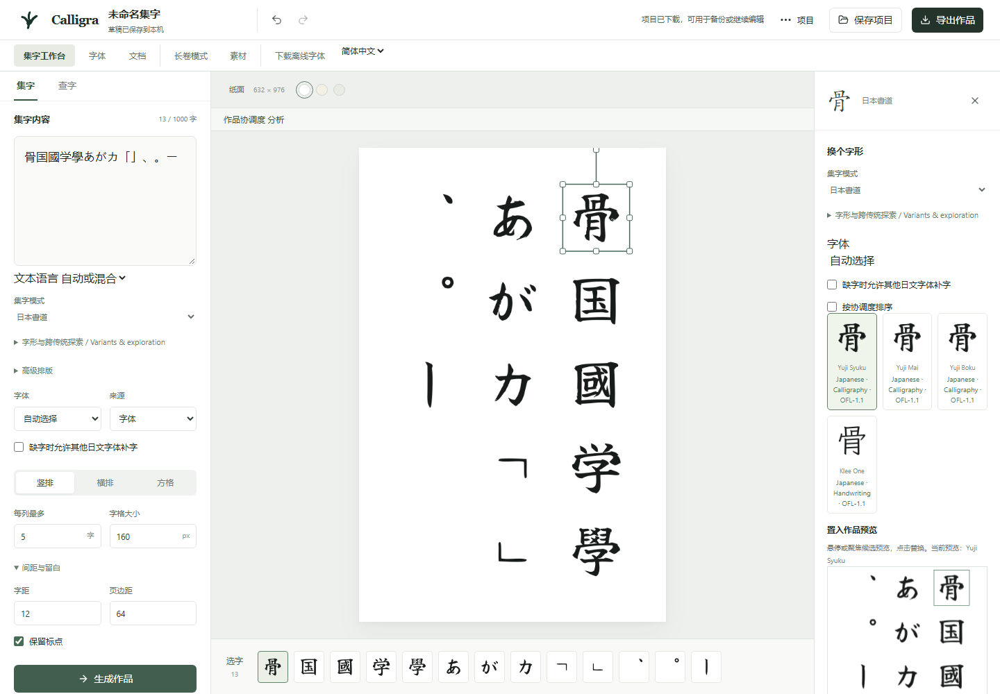

# Calligra

漢字・仮名・ハングルを組み合わせて書作品を制作し、字形の補いから公開まで行えるオープンソースの作業台です。

[English](README.md) · [简体中文](README.zh-CN.md) · [한국어](README.ko.md) · [作業台を開く](https://styayur.github.io/calligra/) · [ダウンロード](https://github.com/styayur/calligra/releases/latest)

- 智能混排、中国書法、日本書道、韓国書芸のモードから選べます。詳細組版では、縦中横、縦書きの句読点、OpenType の合字や異体字シーケンスを扱えます。
- 字形候補の出典と利用条件を確認できます。原本の切り抜き、デジタル書体、部品合成は区別して表示します。文字の訂正は利用者が確定します。古資料 OCR は実験機能です。
- 作品は編集用のプロジェクト、PNG、またはベクター字形と原寸の画像素材を含む PDF として保存できます。長巻は複数ページの PDF に出力できます。

デスクトップでは [PWA](https://styayur.github.io/calligra/)、Android では [署名済み APK](https://github.com/styayur/calligra/releases/latest) を利用できます。フォントをオフライン用に準備すると、接続なしで制作できます。フォントの生成と DOCX・ODT の変換には [ローカル Companion](docs/PWA_COMPANION.md) を使用します。

[出典とライセンス](docs/DATA_SOURCES.md) · [移行とバックアップ](docs/MIGRATIONS.md) · [開発に参加](CONTRIBUTING.md)

プログラムは GPL-3.0-or-later です。配布ファイルは SHA256SUMS.txt で確認できます。
