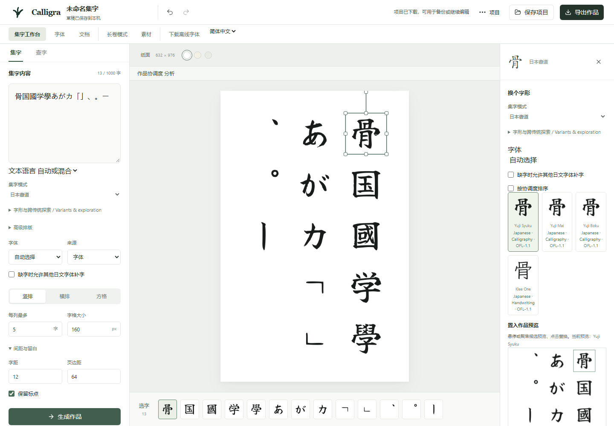

# Calligra

한글, 한자, 가나를 모아 서예 작품을 만들고 글리프를 보완해 내보낼 수 있는 오픈 소스 작업대입니다.

[English](README.md) · [简体中文](README.zh-CN.md) · [日本語](README.ja.md) · [작업대 열기](https://styayur.github.io/calligra/) · [다운로드](https://github.com/styayur/calligra/releases/latest)

- 혼합 조판, 중국 서예, 일본 서도, 한국 서예를 선택하고 원문을 입력합니다. 고급 조판에서는 세로쓰기, 세로쓰기 속 가로 묶음, OpenType 합자와 변이 문자 시퀀스를 다룹니다.
- 글리프 후보의 출처와 사용 조건을 확인할 수 있습니다. 역사 자료의 잘라낸 이미지, 디지털 글꼴, 부품 합성을 구별해 표시하며 글자를 바꾸는 교감은 사용자가 확인합니다. 역사 자료 OCR은 실험 기능입니다.
- 작업을 이어갈 수 있도록 프로젝트를 저장하거나 PNG와 혼합 PDF로 출력합니다. PDF에는 벡터 글리프와 원래 해상도의 역사 이미지가 들어가며, 긴 두루마리는 여러 페이지의 PDF로 내보낼 수 있습니다.

데스크톱에서는 [PWA](https://styayur.github.io/calligra/), Android에서는 [서명된 APK](https://github.com/styayur/calligra/releases/latest)를 사용합니다. 글꼴을 미리 받아 두면 연결 없이 작업할 수 있습니다. 글꼴 제작과 DOCX·ODT 변환에는 [로컬 Companion](docs/PWA_COMPANION.md)이 필요합니다.

[자료 출처와 이용 조건](docs/DATA_SOURCES.md) · [이전과 백업](docs/MIGRATIONS.md) · [개발 참여](CONTRIBUTING.md)

프로그램은 GPL-3.0-or-later로 배포됩니다. 다운로드 파일은 SHA256SUMS.txt로 확인하세요.
