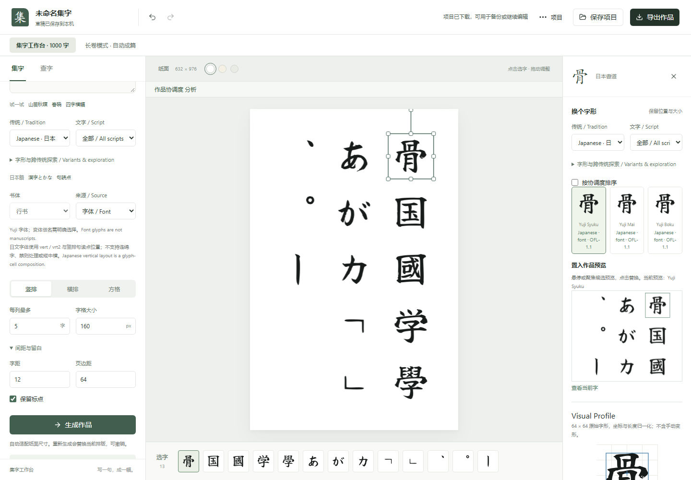

# Calligra

An offline workbench for composing, comparing and exporting Chinese and Japanese calligraphy.

[简体中文](README.zh-CN.md) · [日本語](README.ja.md) · [Live demo](https://styayur.github.io/calligra/) · [Download v0.7.1](https://github.com/styayur/calligra/releases/tag/v0.7.1)

**Stage: Alpha.** Automated checks and release artifacts exist; independent installation, upgrade and sustained user validation remain outstanding. Current application manifests and published downloads are version 0.7.1, but default-branch changes are not automatically included in those downloads.



## Features

- Chinese and Japanese traditions are separated by default; cross-tradition exploration is explicit.
- Compose up to 1,000 characters, replace glyphs, adjust layout and ink, then save project JSON or export artwork. Long-roll mode arranges up to 20,000 characters across pages.
- Visual Profile compares shape, ink density, balance and spacing. Scores help compare candidates; they do not measure artistic quality.
- Bundled fonts and samples work without an account or mandatory API. Sources and applicable rights stay attached to projects and historical-artwork exports.

Japanese sources include Yuji, Klee One, a labelled Source Han Serif JP coverage subset and 20 attributed CODH historical crops. Fonts are contemporary interpretations, not manuscript originals. See [Japanese coverage](docs/JAPANESE_COVERAGE.md), [data sources](docs/DATA_SOURCES.md) and [Visual Profile](docs/visual-profiles.md) for evidence and boundaries.

## Installation / Quick Start

### Published packages

| Platform | v0.7.1 package | Start |
|---|---|---|
| Windows x64 | [Installer](https://github.com/styayur/calligra/releases/download/v0.7.1/CalligraphyStudio-Setup-0.7.1-x64.exe) or [portable executable](https://github.com/styayur/calligra/releases/download/v0.7.1/CalligraphyStudio-Portable-0.7.1-x64.exe) | Install or run the portable executable |
| Web | [Offline ZIP](https://github.com/styayur/calligra/releases/download/v0.7.1/CalligraphyStudio-Web-0.7.1.zip) | Extract and serve over local HTTP |
| Android | [APK](https://github.com/styayur/calligra/releases/download/v0.7.1/CalligraphyStudio-Android-0.7.1.apk) | Android 7.0+ |

Historical filenames still use `CalligraphyStudio`. Check downloads against [SHA256SUMS.txt](https://github.com/styayur/calligra/releases/download/v0.7.1/SHA256SUMS.txt); on Windows use `Get-FileHash <file> -Algorithm SHA256`. Windows packages are unsigned. Android uses the persistent v0.7.1 signing key; physical-device storage, sharing and lifecycle acceptance is pending. See [signing details](docs/RELEASE_SIGNING_0.7.1.md).

For the offline Web ZIP, keep the extracted directories together and run this inside the extracted folder:

```sh
python -m http.server 8080
```

Open `http://localhost:8080`. This local server needs Python 3; editing needs no internet after download. Double-clicking `index.html` is not the supported launch method. The hosted demo first downloads its assets from GitHub Pages; use a downloaded package for explicit offline operation.

### First composition

1. Open the demo or a local package. Select **Chinese** or **Japanese**, enter text and choose a layout.
2. Generate a composition. Select a glyph to inspect its source, compare alternatives and preview a replacement.
3. Save project JSON to continue editing, or export artwork. Back up projects before upgrading; see [schema migrations](docs/MIGRATIONS.md).

Drafts and caches stay on the current device. Export files for backup or transfer. **Long-roll results last only for the current session: export the page ZIP before refreshing.**

### Run from source

Use Node.js 22 (the CI version) and npm:

```sh
git clone https://github.com/styayur/calligra.git
cd calligra/apps/web
npm ci
npm run dev -- --mode desktop
```

Open the URL printed by Vite, normally `http://localhost:5173`. Desktop mode uses bundled static assets; the optional FastAPI/SQLite corpus service is not required. Its development dependencies need Python 3.11+; installation and test commands follow below. See [architecture](docs/ARCHITECTURE.md) and [contributing](CONTRIBUTING.md) for corpus and platform development.

## Testing / CI / Platform Support

[](https://github.com/styayur/calligra/actions/workflows/ci.yml)

From `apps/web`:

```sh
npm run typecheck
npm run test:visual
npm run build:desktop
```

For the optional API, from `apps/api`:

```sh
python -m pip install -r requirements.txt -r requirements-dev.txt
python -m pytest -q
```

The [Verify workflow](.github/workflows/ci.yml) also runs dependency audits, asset/provenance checks, built-browser regressions, packaged Windows renderer checks and Android package builds. [CodeForge regression](.github/workflows/codeforge-regression.yml) is an existing development gate. Windows x64, Web and Android have release artifacts; builds and automated renderer checks do not establish installer, upgrade or physical-device acceptance.

## Known Limitations

- Japanese text uses glyph cells. Full kinsoku, connected-kana continuity, tate-chū-yoko, arbitrary IVS and complete mixed-script vertical orientation are not implemented.
- Historical samples and orthographic mappings are limited; Korean is not supported. The UI is primarily Chinese, with English and selected Japanese terms. README translations do not imply a translated application.
- Large ZIP exports are assembled in memory; rendering can vary between platforms. Long-roll mode does not provide individual glyph dragging.
- Windows installer, upgrade and IME acceptance, plus physical Android storage, sharing and lifecycle checks, remain unverified. Older clients may discard v2 project fields when resaving.

## Roadmap

Next work includes reviewed Japanese mappings and vertical layout coverage, easier local corpus installation, and native-device export validation. Composition presets and tablet input remain future directions. [Phase gates](docs/PHASE_GATES.md) distinguish implemented work from conditional research; no delivery dates are promised.

## Contributing

Read [CONTRIBUTING.md](CONTRIBUTING.md) for development and asset provenance rules. Report reproducible bugs through [Issues](https://github.com/styayur/calligra/issues); use [SECURITY.md](SECURITY.md) for vulnerabilities. Do not commit local databases, caches, exports or unlicensed assets.

## License

Application code is [GPL-3.0-or-later](LICENSE), as declared by current manifests. Fonts, images, datasets and software retain their own terms: OFL-1.1 fonts, CC BY-SA 4.0 CODH crops and derivatives, MIT NCCU samples, and ARPHIC-licensed Hanzi Writer structural data. Restricted MCCD/HCSU data and the full CODH corpus are not bundled.

See [font licenses](docs/FONT_LICENSES.md), [asset policy](docs/asset-policy.md) and [third-party inventory](third_party/manifest.json). Some historical/generated notices still contain an MIT application-code label that conflicts with the current LICENSE; it does not replace that LICENSE. This README change does not resolve those notice inconsistencies or relicense historical releases or third-party assets.
