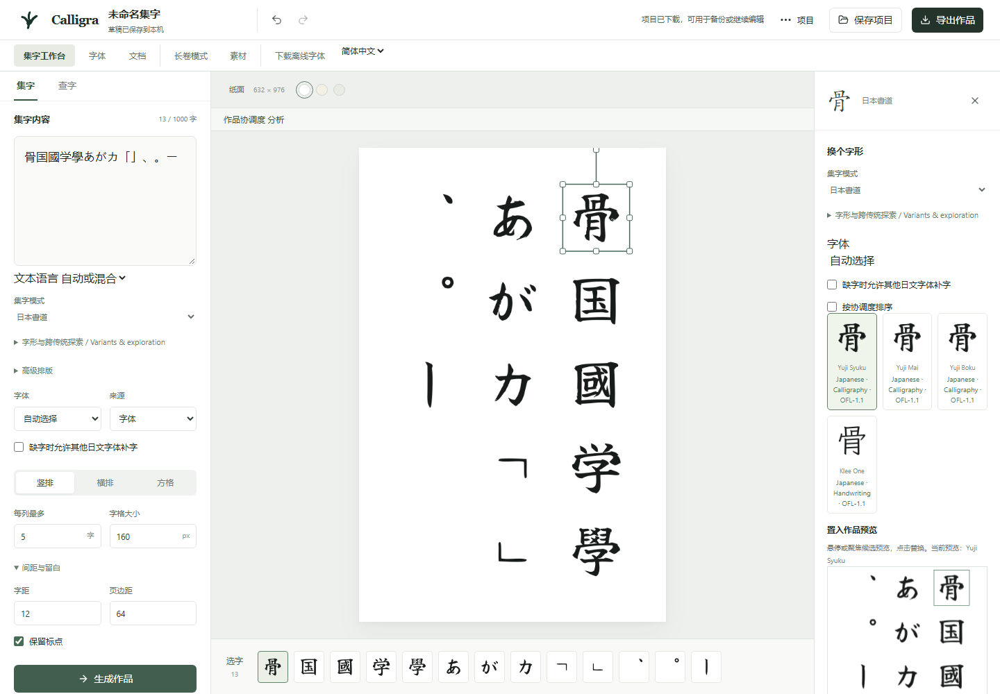

# Calligra

An open-source East Asian calligraphy workbench for composing, restoring and publishing calligraphic works.

[简体中文](README.zh-CN.md) · [日本語](README.ja.md) · [한국어](README.ko.md) · [Open Calligra](https://styayur.github.io/calligra/) · [Downloads](https://github.com/styayur/calligra/releases/latest)

## Make a work

1. Choose Smart Mix, Chinese calligraphy, Japanese calligraphy or Korean calligraphy. Enter your text and generate a composition.
2. Review proposed glyphs, inspect their origins and confirm any editorial substitutions. Use Advanced Typesetting for vertical punctuation, tate-chū-yoko and OpenType shaping.
3. Save a project to edit later. Export PNG or a PDF with vector font outlines and original-sized historical crops. Long Scroll exports a single multi-page PDF, with PNG ZIP available.

Calligra distinguishes sourced historical glyphs, digital fonts and IDS component compositions. A missing transcription remains open for editorial review. Experimental OCR is an optional Companion feature. See the [source and rights records](docs/DATA_SOURCES.md) and [historical OCR results](docs/HISTORICAL_OCR.md).

## Start using Calligra

| Platform | Start |
| --- | --- |
| Windows, macOS, Linux | Open [Pages](https://styayur.github.io/calligra/) and install the PWA if preferred. Serve the unpacked Web ZIP on localhost for an independent copy. |
| Android 7.0+ | Install the signed APK from [Releases](https://github.com/styayur/calligra/releases/latest). The app can check for updates. |
| Local Companion | Run the [optional local service](docs/PWA_COMPANION.md) for installable font compilation or DOCX/ODT conversion. Artwork PDF runs in the browser or Android app. |

Prepare offline fonts while connected, then work offline. Projects and personal libraries are stored on the device. [Migration and backup guide](docs/MIGRATIONS.md) · [Architecture](docs/ARCHITECTURE.md) · [Contributing](CONTRIBUTING.md)

The app is GPL-3.0-or-later. Check the release SHA256SUMS.txt before installing. Each bundled source retains its own rights and attribution.
