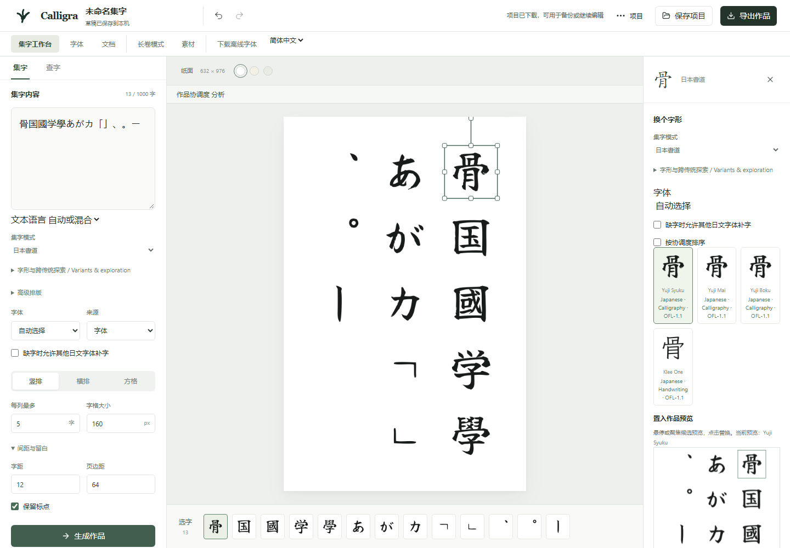

# Calligra

开源东亚书法工作台，用于集字、补字和发布作品。

[English](README.md) · [日本語](README.ja.md) · [한국어](README.ko.md) · [打开工作台](https://styayur.github.io/calligra/) · [下载](https://github.com/styayur/calligra/releases/latest)

- 选择智能混排、中国书法、日本書道或 한국 서예，输入原文生成作品。日文竖排、纵中横、连字和异体字序列可在高级排版中使用。
- 查看补字的来源和许可。同字原帖、数字字体和 IDS 部件合成各有标记，变更原文身份的候选由你确认。历史 OCR 仍为实验功能。
- 保存工程继续编辑，或导出 PNG 与混合 PDF。PDF 内含字体矢量和原分辨率裁片。长卷可导出一个多页 PDF，也可导出 PNG ZIP。

Windows、macOS 和 Linux 可使用 [PWA](https://styayur.github.io/calligra/)，Android 可使用 [签名 APK](https://github.com/styayur/calligra/releases/latest)。联网准备离线字体后即可断网创作。字体工坊和 DOCX/ODT 转换需要 [本机 Companion](docs/PWA_COMPANION.md)。

[字库来源与许可](docs/DATA_SOURCES.md) · [历史 OCR 评测](docs/HISTORICAL_OCR.md) · [迁移和备份](docs/MIGRATIONS.md) · [参与开发](CONTRIBUTING.md)

程序采用 GPL-3.0-or-later。请用 Release 的 SHA256SUMS.txt 核对安装包。
